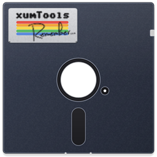
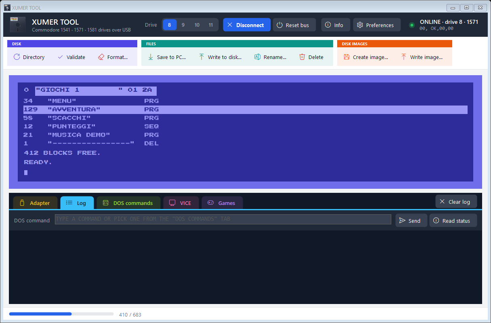
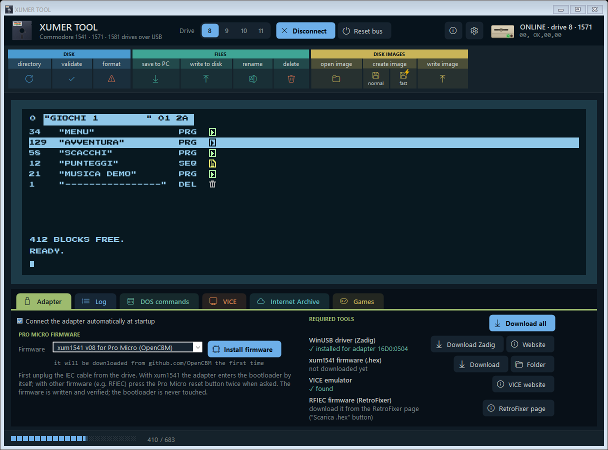
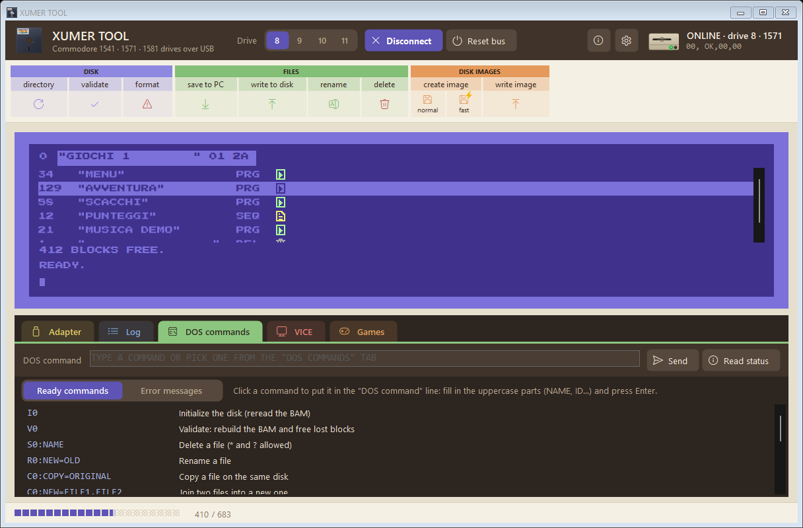
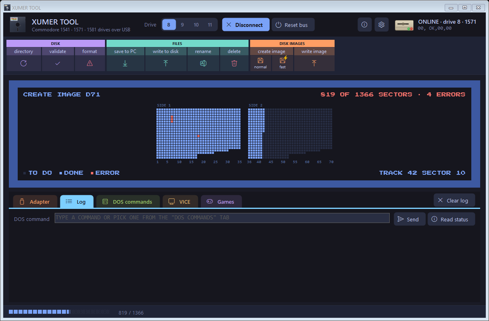
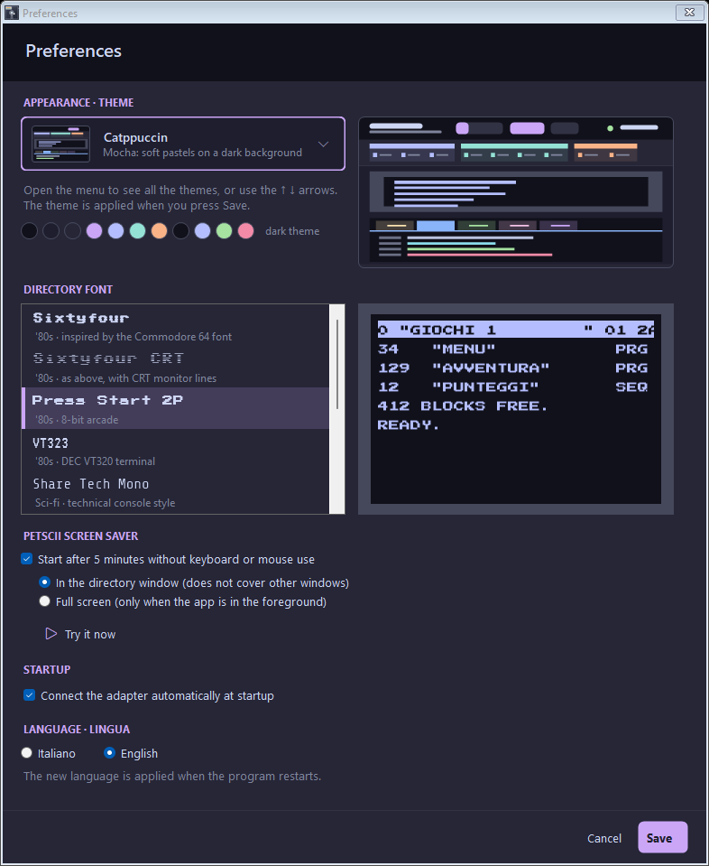
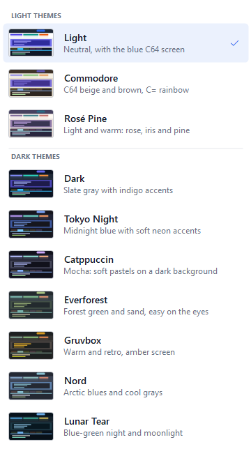

<p align="right"><a href="README.md">Italiano</a> · <b>English</b></p>

<p align="center">
  
</p>

<h1 align="center">XUMER TOOL</h1>

<p align="center">
  Windows program to use Commodore <b>1541</b>, <b>1571</b> and <b>1581</b> disk drives from the PC,<br>
  with the <b>xum1541</b> USB adapter.<br>
  <i>Version 1.2.1b · beta · Italian and English</i>
</p>

<p align="center">
  
</p>

## Features

- **Disk**: directory on the blue C64 screen, validate, format.
- **Files**: save files from the disk to the PC and write PC files to the disk (PRG, SEQ, P00), rename, delete. You can also drag files onto the blue screen.
- **Disk images**: create and write **D64**, **D71** (1571 double-sided) and **D81** images, with a disk map that fills in sector by sector. Plus the experimental **fast copy** (OpenCBM's S2 protocol): a whole disk in about one minute.
- **DOS commands**: command line with a list of ready-made commands, drive status reading and a legend of the error messages with an explanation and what to do.
- **VICE**: run a program, an image or the whole disk in the emulator.
- **Internet Archive**: connect your archive.org account to preserve your disk images (uploading will come in the next version).
- **Adapter**: automatic connection, WinUSB driver check, Zadig download, xum1541 firmware writing to the Pro Micro.
- **Atmosphere**: 10 themes, 10 retro fonts, a drive with LEDs in the header, pixel file icons, a PETSCII block progress bar, original games and a screen saver.
- **Languages**: Italian and English (Preferences → Language). On first start it follows the Windows language.

<p align="center">
  
  
</p>

<p align="center">
  
</p>

## Requirements

- **Windows 10 or 11** (uses .NET Framework 4, already part of Windows).
- An **xum1541** adapter, for example the Arduino Pro Micro one from the [C64-XUM1541](https://github.com/tebl/C64-XUM1541) project, with the OpenCBM xum1541 firmware.
- The **WinUSB** driver for the adapter, installed once with [Zadig](https://zadig.akeo.ie/) (the program can download it for you).
- A Commodore 1541, 1571 or 1581 drive connected to the adapter with the IEC cable.
- Optional: the [VICE](https://vice-emu.sourceforge.io/) emulator.

## Installation

1. Download `XumerTool-1.2.1b-portable.zip` from the **Releases** page, extract the `XUMER TOOL` folder wherever you like and run `XumerTool.exe`. Nothing needs to be installed; to remove it, just delete the folder.
2. Install the driver with Zadig: *Options → List All Devices*, choose **xum1541**, then **WinUSB** and **Install Driver**.
3. Connect the adapter to the drive and to the PC and turn on the drive.
4. Start XUMER TOOL: it connects by itself. Press **Directory**.

> Windows may show the SmartScreen warning because the program is not digitally signed: *More info → Run anyway*.

## Project status (beta)

Tested with real hardware: xum1541 on an Arduino Pro Micro (OpenCBM v08 firmware), a Commodore 1571 and a 1541 (reading and formatting).

Fast copy reading is tested with a 1571 and D64 images.

Still **to be tested on hardware**, use with care:
- fast copy with D71 images and with a 1541;
- writing the firmware to the Pro Micro;
- the 1581 drive (and therefore D81 images): it is supported, but not tested yet.

What's new in each version is in the [changelog](CHANGELOG.en.md); planned work is in the [to-do list](TODO.md).

## Themes

Ten themes, chosen in Preferences from a drop-down list with a preview of the window:
Light, Commodore, Rosé Pine, Dark, Tokyo Night, Catppuccin, Everforest, Gruvbox, Nord and Lunar Tear.

<p align="center">
  
  
</p>

## Building from source

No Visual Studio needed: the C# compiler included in Windows (.NET Framework 4) is enough.

```
build.bat             → bin\XumerTool.exe and bin\xumtest.exe
build-portable.bat    → also bin\XumerTool-<version>-portable.zip (the published version)
```

The code is C# 5 with Windows Forms; the adapter is used through WinUSB, with no external libraries. Code comments are in Italian.

| Folder | Contents |
|---|---|
| `src` | the program (xum1541 protocol, Commodore DOS, interface) |
| `drivecode` | 6502 routines that run inside the drive for fast copy |
| `installer` | LEGGIMI/README texts included in the zip; installer (set aside for now) |
| `fonts` | retro fonts with their licenses |
| `lang` | translations (`en.txt`) |
| `tools` | tools for the icon, the translations and checking the 6502 assembler (`AsmCheck`) |
| `test` | command-line test: `xumtest.exe 8 dir` |

### Translating into another language

Texts are written in Italian in the code and go through `Lang.T("...")`. Translations live in `lang\<code>.txt`, as pairs of lines:

```
it: Salva sul PC…
en: Save to PC…
```

Missing translations are shown in Italian. To add a language: create the file (for example `lang\de.txt`, with `de:` lines), add it to `Lang.Codes` and `Lang.Names` in `src\Lang.cs` and to `build.bat`. `tools\LangTool.cs keys` lists the texts still to translate.

## License and credits

XUMER TOOL is by **darkwave3D** and is released under the [MIT license](LICENSE). Code developed with the support of Claude (Anthropic).

It builds on the work of other projects, which keep their own licenses:
- **OpenCBM** (Michael Klein, Spiro Trikaliotis, Wolfgang Moser and contributors): adapter protocol; the fast-copy 6502 routines (Michael Klein, Joe Forster/STA) are included under the BSD 3-Clause license, see [`licenses`](licenses).
- **xum1541 firmware** (Nate Lawson, from xu1541 by Till Harbaum) and **LUFA** (Dean Camera).
- **C64-XUM1541** (tebl), **RetroFixer**, **IECDevice** (David Hansel).
- Fonts under the SIL Open Font License 1.1 (Sixtyfour by Jens Kutilek and others), see [`fonts`](fonts).
- Theme palettes: Tokyo Night, Catppuccin, Everforest, Gruvbox, Nord, Rosé Pine; Lunar Tear colors inspired by the Blender theme by Raze-Demon; Colodore C64 palette (Pepto).
- External tools, not included: VICE, Zadig, AVRDUDE.

The full list is in the program's **Info** window.
