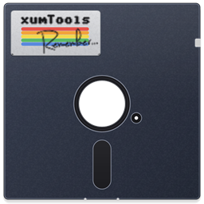
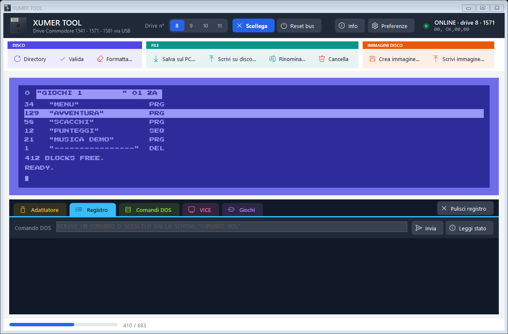
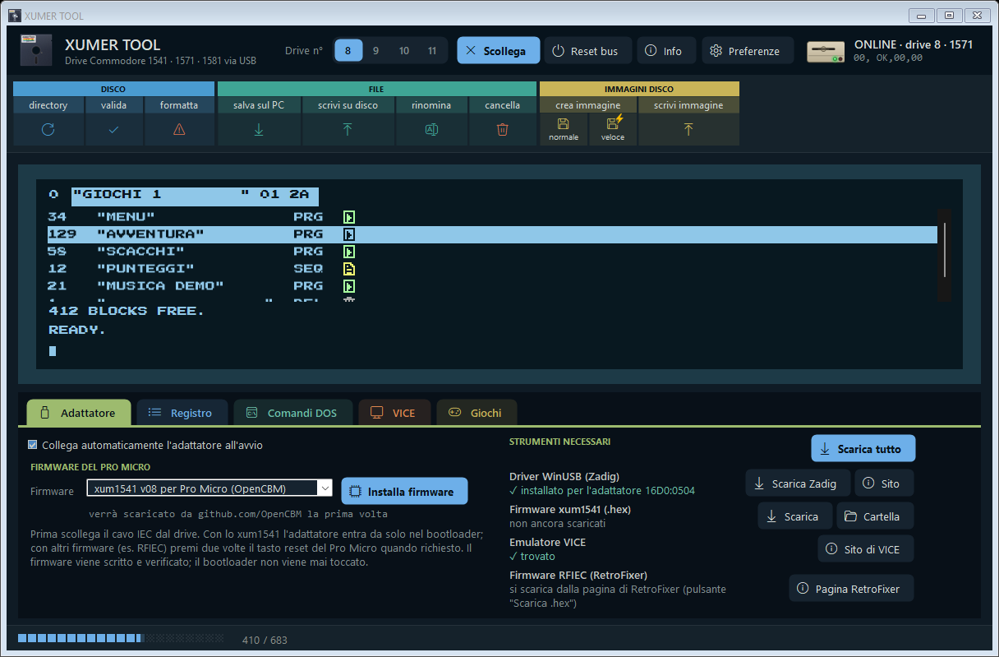
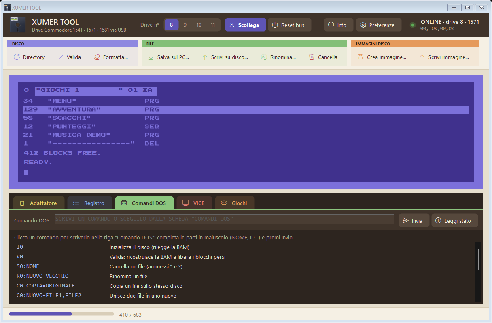
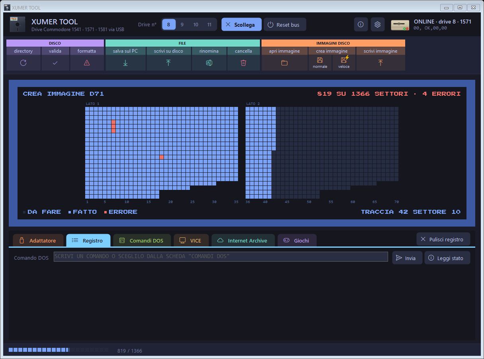
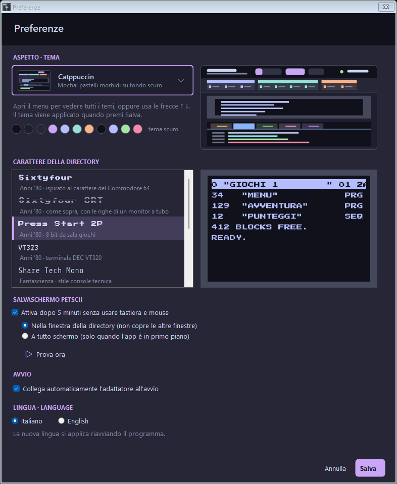
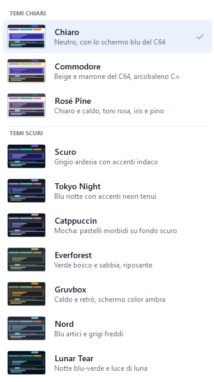

<p align="right"><b>Italiano</b> · <a href="README.en.md">English</a></p>

<p align="center">
  
</p>

<h1 align="center">XUMER TOOL</h1>

<p align="center">
  Programma per Windows per usare i drive Commodore <b>1541</b>, <b>1571</b> e <b>1581</b> dal PC,<br>
  con l'adattatore USB <b>xum1541</b>.<br>
  <i>Versione 1.2.1b · beta · in italiano e in inglese</i>
</p>

<p align="center">
  
</p>

## Cosa fa

- **Disco**: directory nello schermo blu del C64, validazione, formattazione.
- **File**: salva i file del disco sul PC e scrive i file del PC sul disco (PRG, SEQ, P00), rinomina, cancella. Si possono anche trascinare i file sullo schermo blu.
- **Immagini disco**: crea e scrive immagini **D64**, **D71** (1571 doppia faccia) e **D81**, con la mappa del disco che si colora settore per settore. In più la **copia veloce** sperimentale (protocollo S2 di OpenCBM): un disco in circa un minuto.
- **Comandi DOS**: riga di comando con un elenco di comandi pronti, lettura dello stato del drive e legenda dei messaggi di errore con la spiegazione e cosa fare.
- **VICE**: avvia nell'emulatore un programma, un'immagine o tutto il disco del drive.
- **Internet Archive**: collegamento al tuo account archive.org, per conservare le immagini dei dischi (il caricamento arriverà nella prossima versione).
- **Adattatore**: collegamento automatico, controllo del driver WinUSB, download di Zadig, scrittura del firmware xum1541 sul Pro Micro.
- **Atmosfera**: 10 temi, 10 caratteri retro, il drive con i LED nell'intestazione, icone pixel dei file, barra a blocchi PETSCII, giochi originali e salvaschermo.
- **Lingue**: italiano e inglese (Preferenze → Lingua). Al primo avvio segue la lingua di Windows.

<p align="center">
  
  
</p>

<p align="center">
  
</p>

## Cosa serve

- **Windows 10 o 11** (usa .NET Framework 4, già presente in Windows).
- Un adattatore **xum1541**, per esempio quello su Arduino Pro Micro del progetto [C64-XUM1541](https://github.com/tebl/C64-XUM1541), con il firmware xum1541 di OpenCBM.
- Il driver **WinUSB** per l'adattatore, da installare una volta con [Zadig](https://zadig.akeo.ie/) (il programma lo può scaricare per te).
- Un drive Commodore 1541, 1571 o 1581 collegato all'adattatore con il cavo IEC.
- Facoltativo: l'emulatore [VICE](https://vice-emu.sourceforge.io/).

## Installazione

1. Scarica `XumerTool-1.2.1b-portable.zip` dalla pagina **Releases**, estrai la cartella `XUMER TOOL` dove preferisci e avvia `XumerTool.exe`. Non serve installare nulla; per toglierlo basta eliminare la cartella.
2. Installa il driver con Zadig: *Options → List All Devices*, scegli **xum1541**, poi **WinUSB** e **Install Driver**.
3. Collega l'adattatore al drive e al PC e accendi il drive.
4. Avvia XUMER TOOL: si collega da solo. Premi **Directory**.

> Windows potrebbe mostrare l'avviso SmartScreen perché il programma non è firmato digitalmente: *Ulteriori informazioni → Esegui comunque*.

## Stato del progetto (beta)

Provato con l'hardware vero: xum1541 su Arduino Pro Micro (firmware OpenCBM v08), un Commodore 1571 e un 1541 (lettura e formattazione).

La copia veloce in lettura è provata con il 1571 e immagini D64.

Ancora **da provare sull'hardware**, da usare con prudenza:
- la copia veloce con immagini D71 e con il 1541;
- la scrittura del firmware sul Pro Micro;
- il drive 1581 (e quindi le immagini D81): è gestito, ma non ancora provato.

Le novità di ogni versione sono nel [registro delle versioni](CHANGELOG.md); i lavori in programma in [DA_FARE.md](DA_FARE.md).

## Temi

Dieci temi, scelti nelle Preferenze da una tendina con l'anteprima della finestra:
Chiaro, Commodore, Rosé Pine, Scuro, Tokyo Night, Catppuccin, Everforest, Gruvbox, Nord e Lunar Tear.

<p align="center">
  
  
</p>

## Compilare dai sorgenti

Non serve Visual Studio: basta il compilatore C# incluso in Windows (.NET Framework 4).

```
build.bat             → bin\XumerTool.exe e bin\xumtest.exe
build-portable.bat    → in più bin\XumerTool-<versione>-portable.zip (la versione pubblicata)
```

Il codice è in C# 5 con Windows Forms; l'adattatore si usa tramite WinUSB, senza librerie esterne.

| Cartella | Contenuto |
|---|---|
| `src` | il programma (protocollo xum1541, DOS Commodore, interfaccia) |
| `drivecode` | routine 6502 eseguite nel drive per la copia veloce |
| `installer` | testi LEGGIMI/README inclusi nello zip; installer (messo da parte per ora) |
| `fonts` | caratteri retro con le loro licenze |
| `lang` | traduzioni (`en.txt`) |
| `tools` | strumenti per l'icona, per le traduzioni e per controllare l'assemblatore 6502 (`AsmCheck`) |
| `test` | prova da riga di comando: `xumtest.exe 8 dir` |

### Tradurre in un'altra lingua

I testi sono scritti in italiano nel codice e passano da `Lang.T("...")`. Le traduzioni stanno in `lang\<codice>.txt`, a coppie di righe:

```
it: Salva sul PC…
en: Save to PC…
```

Se una traduzione manca compare il testo italiano. Per aggiungere una lingua: crea il file (per esempio `lang\de.txt`, con righe `de:`), aggiungila a `Lang.Codes` e `Lang.Names` in `src\Lang.cs` e a `build.bat`. `tools\LangTool.cs keys` elenca i testi ancora da tradurre.

## Licenza e crediti

XUMER TOOL è di **darkwave3D** ed è distribuito con [licenza MIT](LICENSE). Sviluppo del codice con il supporto di Claude (Anthropic).

Si basa sul lavoro di altri progetti, che mantengono le proprie licenze:
- **OpenCBM** (Michael Klein, Spiro Trikaliotis, Wolfgang Moser e collaboratori): protocollo dell'adattatore; le routine 6502 della copia veloce (Michael Klein, Joe Forster/STA) sono incluse con licenza BSD 3-Clause, vedi [`licenses`](licenses).
- **Firmware xum1541** (Nate Lawson, da xu1541 di Till Harbaum) e **LUFA** (Dean Camera).
- **C64-XUM1541** (tebl), **RetroFixer**, **IECDevice** (David Hansel).
- Caratteri con licenza SIL Open Font License 1.1 (Sixtyfour di Jens Kutilek e altri), vedi [`fonts`](fonts).
- Tavolozze dei temi: Tokyo Night, Catppuccin, Everforest, Gruvbox, Nord, Rosé Pine; colori di Lunar Tear ispirati al tema per Blender di Raze-Demon; tavolozza C64 Colodore (Pepto).
- Strumenti esterni non inclusi: VICE, Zadig, AVRDUDE.

L'elenco completo è nella finestra **Info** del programma.
